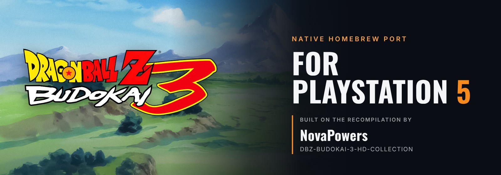
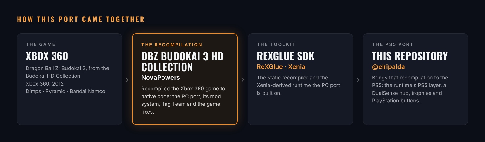

<p align="center">
  
</p>

<p align="center">
  <a href="../../releases/latest"></a>
  
  <a href="https://github.com/novapowers0/DBZ-Budokai-3-HD-Collection"></a>
  <a href="https://discord.gg/GgDE5Vynyu"></a>
</p>

<p align="center">
  <b>Dragon Ball Z: Budokai 3</b> running natively on a jailbroken PS5,<br>
  a port of <a href="https://github.com/novapowers0/DBZ-Budokai-3-HD-Collection"><b>NovaPowers' DBZ Budokai 3 HD Collection</b></a>.
</p>

<p align="center">
  <a href="../../releases/latest"><b>Download</b></a> ·
  <a href="#install">Install</a> ·
  <a href="#controls">Controls</a> ·
  <a href="#building-from-source">Build from source</a> ·
  <a href="#credits">Credits</a>
</p>

---

<p align="center">
  
</p>

> [!NOTE]
> **This is a port of someone else's project.** The recompilation of Budokai 3, the PC port and everything he added to the game are the work of **[NovaPowers](https://github.com/novapowers0)** in [DBZ Budokai 3 HD Collection](https://github.com/novapowers0/DBZ-Budokai-3-HD-Collection), whose code and history are the base of this repository. This repository adds what the PS5 needs to run it (mostly in [`ps5/`](ps5)): the PS5 build, a hub made for the DualSense, trophies and PlayStation button pictures. If you enjoy it, go give the original project a ⭐ and support NovaPowers on [Ko-fi](https://ko-fi.com/novapowers).

## What it is

A PS5 homebrew app (title ID `PPSA93004`) that runs Budokai 3 from the Budokai HD Collection as native code. It isn't an emulator: the Xbox 360 game is statically recompiled with the [ReXGlue SDK](https://github.com/rexglue/rexglue-sdk), as NovaPowers' port does on PC (this release is built on his v1.5.0), and draws on Vulkan (Mesa RADV).

It opens on its own **hub**, where you change settings, manage saves and check your trophies with the controller, then start the game.

> [!IMPORTANT]
> **No game files are included.** You need your **own Xbox 360 copy** of Dragon Ball Z: Budokai HD Collection (the **USA** disc).

## Features

- **60 fps** at 720p (the Xbox 360's), **1440p** (the default) or 4K, with anisotropic filtering.
- **PlayStation buttons**: the game's button pictures in the menus and help bars are PlayStation ones, OPTIONS and the touch pad included, and the Controller screen shows a DualSense with its lines pointing at the right buttons. The Xbox originals are one setting away.
- **Trophies**: Budokai 3's 23 achievements as trophies, plus a platinum. A popup shows in the corner when you earn one, and the hub's Trophies page lists them.
- **Two players** on two DualSense controllers.
- **Online versus (beta)**: PS5 against PS5, with a room code you enter with the controller.
- **The hub**: Home, Settings, Saves, Trophies and About pages, with menu music (a random song each time, **R3** for the next), an FPS counter, and the game's text in English, French or Spanish.
- **Save backups**: back up your saves from the hub.

NovaPowers' fixes and additions to the game come with it. See [his README](README-DBZ-Budokai-3-HD-Collection.md) for those.

## Install

You need a jailbroken PS5 that runs homebrew apps from `/data/homebrew/`, with a homebrew launcher that lists them.

**With [Recomp Store](https://recompstore.com):** install Dragon Ball Z Budokai 3 and give it your disc image. It puts the app in `/data/homebrew/PPSA93004/` and the game in its `Assets/` folder. Start the app and press **START GAME**.

**By hand** (an FTP client):

1. Download `PPSA93004.zip` from [Releases](../../releases) and unzip it on your PC.
2. Over FTP, copy the `PPSA93004` folder into `/data/homebrew/`.
3. Copy the `DBZ3` folder from your disc (extract the `.iso` with a tool such as extract-xiso) into `/data/homebrew/PPSA93004/Assets/`, so you have:
   ```
   /data/homebrew/PPSA93004/Assets/DBZ3/yae3_xenon.xex
   /data/homebrew/PPSA93004/Assets/DBZ3/us/data_cmn.afs
   /data/homebrew/PPSA93004/Assets/DBZ3/us/...
   ```
4. Start **Dragon Ball Z Budokai 3** from your homebrew launcher (with ShadowMountPlus, run its payload again so it picks up the new app) and press **START GAME**.

The hub checks that the game's files are all there. The download's `HOW TO INSTALL.txt` has the same steps.

## Controls

| DualSense | Xbox 360 |
|---|---|
| Cross / Circle / Square / Triangle | A / B / X / Y |
| L1 / R1 | LB / RB |
| L2 / R2 | LT / RT |
| L3 / R3 | stick clicks |
| Options | Start |
| Touchpad click | Back |

In the hub: **L1 / R1** change pages, the **D-pad** picks and changes settings, **Cross** selects, **Circle** goes back, **Options** starts the game, **R3** changes the song.

For two players, the second controller has to be signed in to a PS5 user.

## Online (beta)

In **Duel**, pick **ONLINE**. One player picks **HOST A MATCH** and gets a room code. The other enters it on **CODE** (up and down change a letter, left and right move along, Cross when it's done) and picks **JOIN**. Playing in the same house, use the code the host's screen shows under "From the same house". Over the internet, the host may need to forward UDP port 7777 on their router. Both PS5s need the same version.

## Menu music

Put your own songs (MP3, WAV, FLAC or OGG) in `/data/homebrew/PPSA93004/hub/music/`.

## Updating

Copy a newer `PPSA93004` folder over the old one, or update from Recomp Store. The game (`Assets`), your saves and trophies (`user_data`) and your settings are kept.

## Known issues

- At 4K the busiest fights can drop below 60 fps. 1440p holds 60.
- Online only works PS5 to PS5, not with the PC version.
- Only the USA disc is supported.
- The PC version's launcher and F1 menu aren't on the PS5: the hub has the settings that matter there.

## Reporting a problem

Report bugs on the **[RIPALDA Discord](https://discord.gg/GgDE5Vynyu)**. Send the newest file from `/data/homebrew/PPSA93004/logs/` (and `crashes/` if there is one), with what you were doing.

> [!TIP]
> ### 💙 Enjoying the port?
> If you've gotten some enjoyment out of this project, donations and love are always appreciated. Every bit helps keep these ports growing. Thank you!
>
> [](https://ko-fi.com/ripalda)

## Building from source

The repository's root is DBZ Budokai 3 HD Collection as NovaPowers made it (its Windows and Linux build: see [`README-DBZ-Budokai-3-HD-Collection.md`](README-DBZ-Budokai-3-HD-Collection.md)), with the PS5 changes marked `[ps5 port]` in `src/`. The PS5 port is in [`ps5/`](ps5): the hub, the PS5 start-up, the trophies, the build and the packaging. The runtime with its PS5 layer is `dbz-budokai3-ps5-runtime-v1.0-source.zip` on the [release](../../releases/latest).

You need the runtime (with its `thirdparty/` filled from ReXGlue 0.10.0's submodules), [ps5-plume-triangle](https://github.com/Nazky/ps5-plume-triangle) built once, and your own `yae3_xenon.xex` (the USA disc's `DBZ3/yae3_xenon.xex`) at the root:

```sh
rexglue codegen dbz3_manifest.toml
python3 ps5/tools/ps5_patch_generated.py
cmake -S . -B out/ps5 -G Ninja -DCMAKE_BUILD_TYPE=Release \
  -DCMAKE_TOOLCHAIN_FILE=ps5/cmake/ps5-toolchain.cmake \
  -DPS5_PAYLOAD_SDK=<plume>/.deps/native/ps5-payload-sdk \
  -DREXSDK_DIR=<runtime> -DREXGLUE_HOST_TOOL=<host rexglue>
ninja -C out/ps5 dbz3
ps5/tools/ps5_package.sh out/ps5 <plume> PPSA93004
```

The app folder lands in `out/ps5/ps5-app/PPSA93004`. Packaging also draws the PlayStation buttons (Python 3 with Pillow, NumPy, OpenCV and Shapely). The hub's pictures and the DualSense picture go in `ps5/art/local/` and aren't in the repository. More in [`ps5/README.md`](ps5/README.md).

## Credits

- **[NovaPowers](https://github.com/novapowers0)**: [DBZ Budokai 3 HD Collection](https://github.com/novapowers0/DBZ-Budokai-3-HD-Collection), the recompilation, PC port, mod system and game fixes this port is built on.
- **[ReXGlue](https://github.com/rexglue/rexglue-sdk)**: the static recompiler and runtime.
- **[Xenia](https://xenia.jp)**: the Xbox 360 emulator the runtime's code comes from.
- **PS5 tooling**: the PS5 Payload SDK; Nazky's [ps5-plume-triangle](https://github.com/Nazky/ps5-plume-triangle) and mihawk-99's RADV link recipe; Mesa RADV.
- **Libraries**: Dear ImGui, stb_image, stb_vorbis, dr_mp3, dr_flac; Oswald, Inter and M PLUS Rounded 1c fonts (SIL Open Font License).
- **[@elripalda](https://github.com/elripalda)**: the PS5 port, its hub, the trophies and the PlayStation buttons. Developed with [Claude Code](https://claude.com/claude-code).

## Disclaimer

An unofficial fan project, not affiliated with or endorsed by Bandai Namco, Dimps, Shueisha, Toei Animation, Microsoft or Sony. Dragon Ball Z and all related names and art belong to their owners. This repository and its releases contain no game files: you need your own copy of the game. NovaPowers' code is under the [MIT License](LICENSE); code from other projects keeps its own licence (see [THIRD_PARTY.md](THIRD_PARTY.md)).
